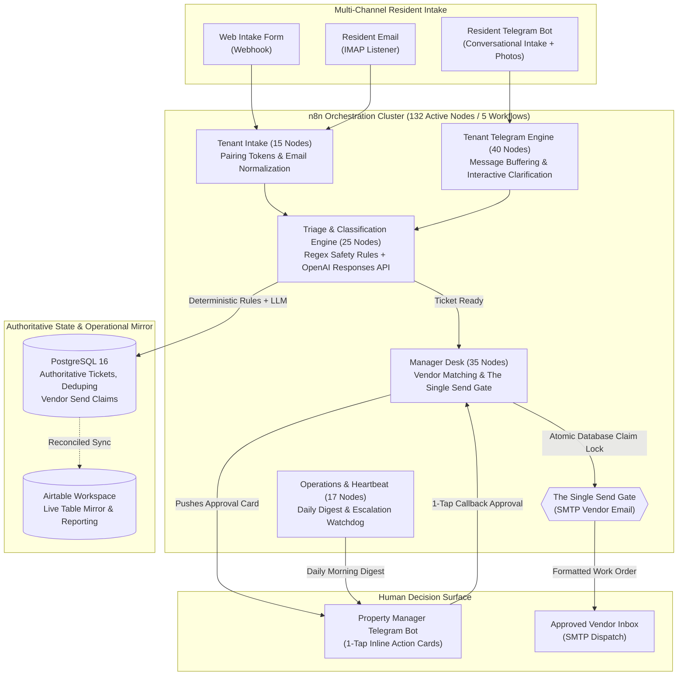

# Multi-Channel Ticket Triage & Automated Routing System

[](https://n8n.io)
[](https://www.postgresql.org)
[](https://www.docker.com)
[](https://core.telegram.org/bots/api)
[](https://airtable.com)
[](#the-single-path-to-irreversible-action)

> **An event-driven property management maintenance triage engine that ingests unstructured tenant repair requests across email, web forms, and Telegram, classifies urgency with deterministic safety rules, matches qualified vendors, and routes 1-tap approval cards to managers with a structural human-in-the-loop guarantee.**

---

## The Operational Problem

Maintenance coordination is the primary operational friction point in residential property management:
* **The #1 Turnover Driver**: Slow maintenance response is the leading cause of resident non-renewals (*Buildium / NARPM State of the Industry Report*). 31% of tenants uncertain about renewing report they would stay if property maintenance were more responsive.
* **Unstructured Inbound Chaos**: Tenants submit requests at all hours with wildly varying descriptions. A tenant might report an active gas leak apologetically in sentence nine of a long email, or complain about a squeaking cabinet door in all caps at 11:00 PM on Friday.
* **The Dual-Risk Failure Mode**:
  * *Under-Response (Habitability Liability)*: Failing to recognize an active water leak or gas smell risks thousands of dollars in property damage and statutory habitability violations.
  * *Over-Response (Inflated Expense)*: Dispatching an emergency plumber at weekend overtime rates ($300+) for a simple running toilet that could wait for Monday routine maintenance.
* **The After-Hours Coverage Gap**: Standard office hours cover only 40 of the 168 hours in a week. The remaining 128 hours typically rely on costly third-party call centers that lack context and default to expensive emergency dispatches.

### The Solution
This system is an **autonomous maintenance intelligence and dispatch pipeline**:
1. **Multi-Channel Intake**: Accepts tenant requests via Web Form, Email (IMAP), and a dedicated Tenant Telegram Bot with conversational follow-up and photo ingestion.
2. **Two-Stage Urgency Classification**: Evaluates requests using OpenAI's Responses API under strict JSON schemas, bounded by hardcoded keyword safety rules that can raise urgency (Emergency, Urgent, Routine) but can never lower it.
3. **Conversational Clarification**: Automatically queries the tenant for missing troubleshooting details before a manager is ever interrupted.
4. **Smart Vendor Matching**: Automatically pairs the verified trade category with approved vendors from the database based on specialty, rating, and insurance status.
5. **Topological Human-in-the-Loop Gate**: Pushes an interactive card to the property manager's phone with 1-tap dispatch buttons: `[Approve & Dispatch]`, `[Hold]`, or `[Request More Info]`.

---

## System Architecture



---

## Core Engineering Highlights & Guarantees

### 1. The Single Path to Irreversible Action
Contacting an outside contractor commits client funds and sets expectations that cannot be rolled back.
* Across all **132 nodes in the active production workflows**, exactly **one node** can email a vendor: `SMTP Send Approved Vendor Email` inside `maintenance-triage-manager-desk.json`.
* **Zero Trigger Invariant**: This node sits on an unbroken linear execution chain starting exclusively at `ManagerTelegramTrigger` (a manager tapping a button on their phone).
* **Atomic Database Lock**: Before transmitting the email, the workflow executes a PostgreSQL atomic claim:
  ```sql
  INSERT INTO triage.vendor_send_attempts (ticket_id, sent_at)
  VALUES ($1, NOW())
  ON CONFLICT (ticket_id) DO NOTHING
  RETURNING *;
  ```
* If a manager double-clicks the button or two managers tap simultaneously, the second call inserts nothing, returns empty, and halts execution before reaching the SMTP node.
* **Result**: Zero unauthorized or duplicate dispatches, enforced at the database constraint level.

### 2. Dual-Layer Safety Bounds (Regex Pre-Screen + Strict JSON Schema)
Prompts can drift, but physical safety cannot be compromised.
* **Pre-LLM Hard Keyword Rules**: Inbound text is scanned against high-hazard keyword matrices (gas leak, flooding, electrical sparking, carbon monoxide, door lock broken).
* **The Ratchet Rule**: Hardcoded safety rules can **only escalate urgency (Routine -> Urgent -> Emergency)**; they can never lower it. If an LLM classifies a message as routine, but the text contains "smell gas", the safety rule overrides the classification to Emergency.
* **Strict Model Contract**: OpenAI calls use direct HTTP to the Responses API with `strict: true` JSON schemas (`category`, `urgency`, `diagnosis`, `recommended_action`, `clarification_needed`). The model cannot hallucinate free-form keys.

### 3. Asynchronous Conversational Buffering & Clarification
Tenants rarely send complete requests in a single message.
* When a tenant sends multiple short messages (*"my sink is leaking"*, *"actually it's the pipe underneath"*, *"sending a photo"*), the **Tenant Telegram Engine** buffers inputs across a 60-second sliding window before triggering triage.
* If critical information is missing (e.g., appliance brand or water shutoff status), the engine asks one conversational follow-up directly to the tenant before notifying management.

### 4. Dual Telegram Bot Architecture
To prevent message collision and security breach, the system operates **two distinct Telegram bot tokens**:
1. **Tenant Bot**: Conversational intake, token-based unit pairing, photo ingestion, and status inquiries.
2. **Manager Bot**: Administrative action surface, emergency escalation alerts, inline vendor selection keyboards, and 7:00 AM daily digests.
Tenant interactions can never trigger manager callbacks or view internal property records.

---

## Workflow Architecture (132 Active Production Nodes)

| Workflow File | n8n ID | Nodes | Core Operational Responsibilities |
| :--- | :--- | :---: | :--- |
| **`maintenance-triage-core.json`** | `maintenance-triage-core-stage-4` | 25 | Message normalization, deduplication, LLM classification, safety ratchet rules, draft generation. |
| **`maintenance-triage-tenant-intake.json`** | `mt-tenant-intake-stage-9` | 15 | Webhook form & IMAP email intake, token pairing generation, onboarding invitations. |
| **`maintenance-triage-tenant-telegram.json`** | `mt-tenant-telegram-stage-9` | 40 | Conversational tenant interface, message buffering, clarification queries, photo uploads. |
| **`maintenance-triage-manager-desk.json`** | `mt-manager-desk-stage-9` | 35 | Vendor candidate matching, dynamic Telegram approval cards, **The Single Send Gate**. |
| **`maintenance-triage-operations.json`** | `mt-operations-stage-9` | 17 | Scheduled heartbeat, 7:00 AM daily digest, emergency SLA escalation watchdog. |

*(An additional 7 helper and driver workflows are included for fixture testing, synthetic stress runs, and legacy stage rollbacks).*

---

## Tech Stack

* **Workflow Orchestration**: [n8n v2.x](https://n8n.io) (Self-Hosted on Docker Compose)
* **Authoritative Database**: [PostgreSQL 16](https://www.postgresql.org) (Schema migrations, partial indexes, atomic locks)
* **Manager & Tenant Surfaces**: [Telegram Bot API](https://core.telegram.org/bots/api) (Dual-bot architecture)
* **Operational Mirror**: [Airtable API](https://airtable.com) (Team visibility and reporting)
* **AI Intelligence**: [OpenAI Responses API](https://platform.openai.com) (`gpt-5.6-luna` with locked JSON Schemas)
* **Email Layer**: IMAP (Inbound Tenant Mail) + SMTP (Outbound Vendor Dispatch)

---

## Local Setup & Quickstart

### Prerequisites
* Docker & Docker Compose
* PowerShell (Windows) or Bash (macOS/Linux)
* Node.js v18+

### Setup Instructions

1. **Clone the Repository:**
   ```bash
   git clone https://github.com/SambhavJain26/maintenance-triage.git
   cd maintenance-triage
   ```

2. **Configure Environment:**
   ```bash
   cp .env.example .env
   ```
   Add your PostgreSQL passwords, n8n encryption key, OpenAI API key, and Telegram Bot tokens to `.env`.

3. **Start the Database and Orchestrator:**
   ```bash
   docker compose up -d postgres n8n
   ```

4. **Initialize Database Schema & Test Fixtures:**
   ```powershell
   # In PowerShell
   .\scripts\seed-fixtures.ps1
   ```

5. **Import & Publish Active Workflows:**
   ```powershell
   .\scripts\import-stage-9-workflows.ps1 -PublishLiveTriggers
   ```

---

## Technical Trade-offs & Engineering Decisions

| Decision | Selected Approach | Alternative Rejected | Rationale |
| :--- | :--- | :--- | :--- |
| **State Authority** | PostgreSQL 16 | Airtable / Google Sheets | Airtable cannot enforce atomic locks or unique ticket constraints. Postgres guarantees zero duplicate vendor sends via `ON CONFLICT DO NOTHING` locks. |
| **Interface Strategy** | Dual Telegram Bots | Web App / Resident Portal | Field managers and tenants avoid installing custom portals. Telegram provides native photo uploads, instant push alerts, and 1-tap inline buttons. |
| **AI Architecture** | Direct HTTP Responses API | Tool-Calling Agent Loops | Unbounded agent loops risk hallucination and high token costs. Deterministic JSON Schemas provide predictable latency and locked outputs. |
| **Safety Logic** | Hardcoded Regex Ratchet | Prompt Engineering Alone | Prompts can drift or be jailbroken by angry tenant text. Code-level regex safety rules guarantee that life-safety hazards can never be downgraded. |

---

## License & Security
Private Client Build: Proprietary Intellectual Property. All tenant names, addresses, and vendor identities in this repository are synthetic test fixtures.
